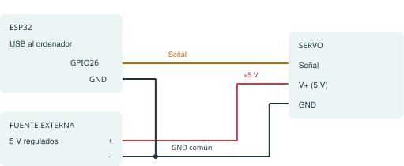

# 1. Antes de empezar

**Objetivo:** jugar en el ordenador y controlar un servo conectado a un ESP32 por Wi-Fi. Esta guía está escrita para Windows y se sigue en orden. Cada etapa termina con una comprobación.

**Recorrido:** materiales → juego en práctica → cables → Arduino y Wi-Fi → cargar programa → movimiento y montaje → resolver problemas.

## Materiales

| Cantidad | Necesitas | Comprueba antes de usarlo |
| --- | --- | --- |
| 1 | ESP32 clásico con USB y pines soldados | GPIO26 accesible; esta guía usa ESP32 Dev Module. No asumas que un C3 o S3 es equivalente. |
| 1 | Servo de posición de unos 180° | Compatible con señal de 3,3 V y alimentación elegida. Un servo de giro continuo no sirve. |
| 1 | Fuente regulada para el servo | Tensión admitida por el servo; para el esquema, 5 V. Corriente suficiente según su ficha, incluido arranque/bloqueo. |
| 1 | Cable USB de datos | Compatible con el conector de tu placa; un cable solo de carga no sirve para programar. |
| Varios | Cables y conectores | Para señal y para alimentación; estos últimos adecuados a la corriente del servo. |
| 1 conjunto | Base, soporte, brazo, horn y tornillos | El horn es la pieza que encaja en el eje. Añade una cazoleta y una pelota blanda. |
| 1 | Ordenador Windows y red local | El ESP32 clásico necesita Wi-Fi de 2,4 GHz. El PC debe estar en la misma red local. |

El ordenador puede estar por cable o por otra banda del mismo router si ambos dispositivos pueden comunicarse. Evita redes de invitados que los aíslen.

## Qué falta para copiar exactamente la catapulta

El repositorio todavía no incluye modelos concretos de servo y fuente, medidas de base y brazo, ni plano de fijaciones. **No es aún un kit mecánico listo para reproducir sin tomar decisiones.** Puedes probar el juego y la electrónica; antes de comprar o fabricar la estructura debes concretar esos datos. La fuerza necesaria depende del brazo y de la carga.

**Al terminar:** sabes qué piezas tienes y cuáles falta confirmar. Puedes hacer la siguiente etapa sin comprar ni conectar hardware.

<!-- page -->

# 2. Descarga y prueba el juego

## Descarga el proyecto

1. Abre [el repositorio de GitHub](https://github.com/CarlesFor/catapulta_proyecto).
2. Pulsa el botón **Code** y después **Download ZIP**. No necesitas cuenta de GitHub ni instalar Git.
3. En Descargas, pulsa con el botón derecho sobre el ZIP y elige **Extraer todo**.
4. Abre la carpeta extraída hasta ver `README.md`, `python_code` y `catapult_code`. Esta será la **carpeta del proyecto**. No trabajes dentro del ZIP.

## Instala y comprueba Python

Instala Python 3 desde [la página oficial para Windows](https://www.python.org/downloads/windows/), siguiendo su instalador. El proyecto se ha probado con Python 3.12; otras versiones no se han validado aquí.

En la carpeta del proyecto, haz clic en la barra de direcciones del Explorador, escribe `powershell` y pulsa Intro. Copia cada comando por separado y pulsa Intro:

```powershell
py --version
py -m tkinter
```

El primero debe mostrar una versión de Python 3. El segundo debe abrir una pequeña ventana: ciérrala para continuar. Si `py` no existe pero `python --version` muestra Python 3, usa `python` en lugar de `py` en toda la guía. Si ninguno funciona, termina la instalación y abre una terminal nueva.

## Abre el juego en práctica

```powershell
py python_code/app_catapulta.py --demo
```

Debe aparecer **PRÁCTICA** y una barra en movimiento. Haz clic en la barra y pulsa **Espacio**: el marcador se detiene. Otra pulsación inicia una ronda nueva. También puedes usar el botón **DETENER**. Cierra el juego cuando termines.

**Al terminar:** puedes jugar sin placa. Si no, ve al apartado 7 antes de seguir con los cables. No necesitas PyCharm ni instalar paquetes con pip.

<!-- page -->

# 3. Conecta los cables

**Desconecta el USB y apaga la fuente antes de cablear. Deja el brazo fuera del servo.** El esquema muestra conexiones eléctricas, no la posición física de los pines.



| Desde | Hasta |
| --- | --- |
| GPIO26 / IO26 del ESP32 | Señal del servo |
| Positivo de la fuente, +5 V si el servo lo admite | V+ del servo |
| Negativo de la fuente | GND del servo |
| GND del ESP32 | El mismo negativo de la fuente |
| USB del ordenador | USB del ESP32, cuando llegue el momento de encender |

**GND** es la referencia eléctrica común: el ESP32, el servo y la fuente deben compartirla. Busca el nombre GPIO26 o IO26 impreso en la placa; no cuentes hasta el pin físico 26.

En muchos servos, rojo es V+, marrón/negro es GND y amarillo/naranja/blanco es señal. Confirma los colores en la ficha de tu servo.

Alimenta el ESP32 por USB y el servo por su fuente. No conectes el servo a 3V3 ni a un GPIO como alimentación. En este esquema, el positivo de la fuente externa va solo al servo; no lo unas a los pines 5V/3V3 del ESP32.

**Al terminar:** hay señal en GPIO26 y una masa común. La fuente sigue apagada y el brazo desmontado. Referencias: [alimentación de servos](https://learn.adafruit.com/using-servos-with-circuitpython/hardware) y [pines del ESP32-DevKitC](https://docs.espressif.com/projects/esp-dev-kits/en/latest/esp32/esp32-devkitc/user_guide.html).

<!-- page -->

# 4. Prepara Arduino y tu Wi-Fi

## Instala las herramientas de la placa

1. Descarga e instala [Arduino IDE](https://support.arduino.cc/hc/en-us/articles/360019833020-Download-and-install-Arduino-IDE).
2. Abre **Archivo → Preferencias**. En **URLs adicionales del Gestor de placas**, añade la siguiente dirección sin borrar otras que ya tengas:

```text
https://espressif.github.io/arduino-esp32/package_esp32_index.json
```

3. Abre el **Gestor de placas**, busca `esp32` e instala **esp32 by Espressif Systems**.
4. Abre el **Gestor de bibliotecas**, busca `ESP32Servo` e instala esa biblioteca. `WiFi` y `WebServer` vienen con el paquete ESP32.
5. En **Archivo → Abrir**, elige `catapult_code/sketch_aug19a/sketch_aug19a.ino`. Conserva ese archivo dentro de su carpeta `sketch_aug19a`.

Los nombres de menús pueden variar con el idioma. Instrucciones oficiales: [instalar el soporte ESP32](https://docs.espressif.com/projects/arduino-esp32/en/latest/installing.html) y [biblioteca ESP32Servo](https://github.com/madhephaestus/ESP32Servo).

## Crea tu archivo privado

En el Explorador entra en `catapult_code/sketch_aug19a`. Activa **Ver → Mostrar → Extensiones de nombre de archivo** (en Windows 10, **Vista → Extensiones de nombre de archivo**).

Copia `wifi_config.h.example` en esa misma carpeta y renombra la copia a **wifi_config.h**. Acepta el cambio de extensión. No debe llamarse `wifi_config.h.txt` ni terminar en `.example`.

Abre la copia con el Bloc de notas y sustituye solo los textos entre comillas:

```cpp
#pragma once
#define CATAPULT_WIFI_SSID "NOMBRE_DE_TU_WIFI"
#define CATAPULT_WIFI_PASSWORD "CONTRASENA_DE_TU_WIFI"
```

Guarda el archivo. Respeta mayúsculas, minúsculas y espacios de tu red. Si un valor contiene una comilla doble, escribe `\"`; si contiene una barra invertida, escribe `\\`. No publiques este archivo; Git lo excluye, pero una copia manual o un ZIP puede incluirlo.

**Al terminar:** en la misma carpeta están el `.ino`, la plantilla y tu `wifi_config.h`. La configuración se incorpora al compilar; cambiar de Wi-Fi exige volver a subir el programa.

<!-- page -->

# 5. Carga el programa y encuentra la IP

La fuente del servo debe seguir apagada. Conecta solamente el USB del ESP32 al ordenador.

## Selecciona placa y puerto

1. En Arduino IDE selecciona **Herramientas → Placa → esp32 → ESP32 Dev Module**, para la placa clásica prevista en esta guía.
2. En **Herramientas → Puerto**, elige el puerto COM de la placa. Si dudas, desconecta el USB, observa qué puerto desaparece y vuelve a conectarlo.
3. Pulsa **Verificar** (marca de comprobación). Debe terminar sin errores.
4. Pulsa **Subir** (flecha hacia la derecha). Espera a que termine la carga. No desconectes el USB mientras escribe.

Si no aparece puerto, revisa el cable de datos y el controlador USB correspondiente al modelo de placa. Si la carga se queda en `Connecting...`, algunas placas necesitan mantener **BOOT** pulsado mientras empieza la conexión y soltarlo cuando comienza la escritura. No cambies opciones al azar: consulta el modelo de placa si persiste.

## Lee la dirección de la placa

Abre **Herramientas → Monitor serie**, selecciona **115200 baudios** y pulsa **EN/RESET** en la placa. Espera a que aparezca:

```text
WiFi conectado. Mi direccion IP es: ...
```

Copia los números que aparecen en lugar de los puntos. Esa es la **IP**, la dirección del ESP32 dentro de tu red. Puede cambiar al reiniciar o cambiar de red. El mensaje «Servidor HTTP iniciado» por sí solo no confirma que el Wi-Fi esté conectado.

En el navegador del ordenador escribe `http://IP_DE_TU_PLACA/estado`, sustituyendo `IP_DE_TU_PLACA` por los números reales. Debes ver texto con `"api_version":1` y `"estado":"listo"`. Esta consulta no dispara el servo.

**Al terminar:** el navegador recibe el estado. Si no responde, revisa la conexión en el apartado 7 antes de encender la fuente. La IP `192.0.2.1` que trae el juego es ficticia.

<!-- page -->

# 6. Del servo al primer tiro

## Comprueba el servo sin brazo

1. Con el ESP32 ya programado y encendido por USB, enciende la fuente del servo. El programa ordena la posición de reposo de **120°**.
2. Desde la carpeta del proyecto abre el juego:

```powershell
py python_code/app_catapulta.py --demo
```

3. Desmarca **Práctica** para habilitar el campo IP y el botón **Conectar**. Escribe la IP real y pulsa **Conectar**. Espera a ver **ESP32 CONECTADO**.
4. Con el eje despejado, haz clic en la barra y pulsa **Espacio**. El servo debe moverse y regresar al reposo tras aproximadamente un segundo. Otra pulsación inicia una ronda nueva.

En un borde de la barra, la orden es **120° → 108° → 120°**. En el centro, **120° → 0° → 120°**. Si zumba continuamente, golpea un tope, se calienta o la placa se reinicia, apaga la fuente y revisa el montaje.

## Monta el brazo

Esta parte depende de tus piezas; aún faltan planos y medidas específicos en el proyecto.

1. Fija el servo a un soporte estable para que su carcasa no gire.
2. Deja que vuelva a 120°. Apaga la fuente y desconecta el USB.
3. Encaja el horn sin girar a la fuerza el eje. Fija el brazo al horn y monta el tornillo del eje.
4. Orienta el conjunto para que el recorrido ordenado de 120° a 0° quede libre de base, cables y topes. No fuerces el servo a mano para probarlo.
5. Enciende de nuevo y prueba sin pelota, primero cerca de un borde de la barra. Confirma el recorrido libre antes de probar el centro.
6. Solo entonces prueba con una pelota blanda y ligera, con la zona de lanzamiento despejada y sin apuntar a personas o animales.

El porcentaje del juego indica **recorrido angular**, no fuerza medida ni distancia garantizada. La aplicación confirma el estado del programa de la placa; no hay un sensor que compruebe la posición física del brazo.

**Al terminar:** el brazo vuelve al mismo reposo después de cada tiro. Para apagar, cierra el juego, apaga la fuente del servo y desconecta el USB. Nunca recoloces cables o el brazo con alimentación.

<!-- page -->

# 7. Si algo no funciona

Busca el síntoma y haz la comprobación indicada antes de repetir el paso.

| Síntoma | Qué hacer |
| --- | --- |
| `py` no se reconoce | Abre una terminal nueva tras instalar Python. Prueba `python --version`; si muestra Python 3, sustituye `py` por `python`. |
| `No module named tkinter` | Revisa la instalación de Python y su componente Tcl/Tk. Comprueba `py -m tkinter`; no se resuelve instalando tkinter con pip. |
| `can't open file` al abrir el juego | Abre PowerShell desde la carpeta que contiene `python_code`, fuera del ZIP extraído. |
| `wifi_config.h: No such file` | Crea la copia junto al `.ino`; comprueba que no termine en `.txt` o `.example`. |
| `ESP32Servo.h: No such file` | Instala ESP32Servo en el Gestor de bibliotecas de Arduino IDE. |
| No aparece un puerto COM | Prueba otro cable USB de datos y otro puerto; identifica el controlador USB de tu placa en su documentación. |
| Error al cargar o `Connecting...` permanente | Revisa placa y puerto seleccionados. Cierra programas que usen ese COM; prueba BOOT según el apartado 5. |
| Monitor serie ilegible o vacío | Selecciona 115200 baudios y el puerto correcto; pulsa EN/RESET. |
| No aparece una IP | Revisa Wi-Fi de 2,4 GHz y las credenciales en el archivo privado; guarda y vuelve a subir el programa. |
| El navegador no abre `/estado` | Relee la IP tras reiniciar. Comprueba que PC y ESP32 estén en la misma red y sin aislamiento de invitados. |
| IP y Conectar están desactivados | Desmarca Práctica y espera a que termine cualquier operación en curso. |
| El juego pide actualizar el firmware | Sube el `.ino` de esta misma descarga y vuelve a conectar. |
| Se detiene la barra pero el servo no se mueve | Confirma Práctica desmarcada, ESP32 CONECTADO y fuente del servo encendida; revisa GPIO26 y GND común con todo apagado. |
| El servo tiembla, fuerza o reinicia la placa | Apaga la fuente. Revisa tensión, corriente disponible, conexiones, masa común y obstáculos mecánicos. |
| Espacio no detiene el marcador | Haz clic en la barra; al escribir en el campo IP no se dispara con Espacio. |

Si un tiro da error, observa primero la catapulta: puede haberse movido aunque se haya perdido la respuesta. El juego no reenvía automáticamente la orden.

<!-- page -->

# 8. Uso diario y ayuda

## La próxima vez

1. Comprueba que el brazo y su recorrido estén despejados.
2. Conecta el USB del ESP32 y enciende la fuente del servo.
3. Si la IP ha cambiado, léela en el monitor serie a 115200 baudios.
4. Abre el juego con `py python_code/app_catapulta.py --demo`.
5. Desmarca Práctica, introduce la IP y pulsa Conectar.
6. Con **ESP32 CONECTADO**, pulsa Espacio para detener la barra. Vuelve a pulsarlo para otra ronda.

No hace falta volver a cargar el programa cada vez. Hazlo cuando cambies el firmware o los datos Wi-Fi.

## Si pides ayuda

Indica el paso de esta guía donde te quedas, el mensaje de error, modelo de placa, servo y fuente, y las versiones de Python, Arduino IDE, paquete ESP32 y ESP32Servo. No compartas `wifi_config.h`, contraseñas ni compilaciones del firmware.

## Qué está comprobado

Las pruebas automáticas cubren la lógica del juego, comunicación HTTP y comportamiento del programa del servo con dobles de Arduino. No certifican el montaje físico, la corriente disponible ni la distancia de lanzamiento. Python se probó con la versión 3.12.

La interfaz y el programa del ESP32 están incluidos. Para convertir esto en un montaje completamente reproducible siguen pendientes los modelos exactos de servo/fuente, plano de base y brazo, fijaciones y validación física.

## Documentación de consulta

- [Proyecto y futuras actualizaciones](https://github.com/CarlesFor/catapulta_proyecto).
- [Instalar Arduino IDE](https://support.arduino.cc/hc/en-us/articles/360019833020-Download-and-install-Arduino-IDE).
- [Instalar el paquete ESP32](https://docs.espressif.com/projects/arduino-esp32/en/latest/installing.html).
- [Pines y alimentación de ESP32-DevKitC](https://docs.espressif.com/projects/esp-dev-kits/en/latest/esp32/esp32-devkitc/user_guide.html).
- [Biblioteca ESP32Servo](https://github.com/madhephaestus/ESP32Servo).
- [Cableado y alimentación del servo](https://learn.adafruit.com/using-servos-with-circuitpython/hardware).
- [Python para Windows](https://www.python.org/downloads/windows/) y [comprobar Tkinter](https://docs.python.org/3/library/tkinter.html).

Esta guía y el PDF se generan desde el mismo texto para mantener los pasos sincronizados.
